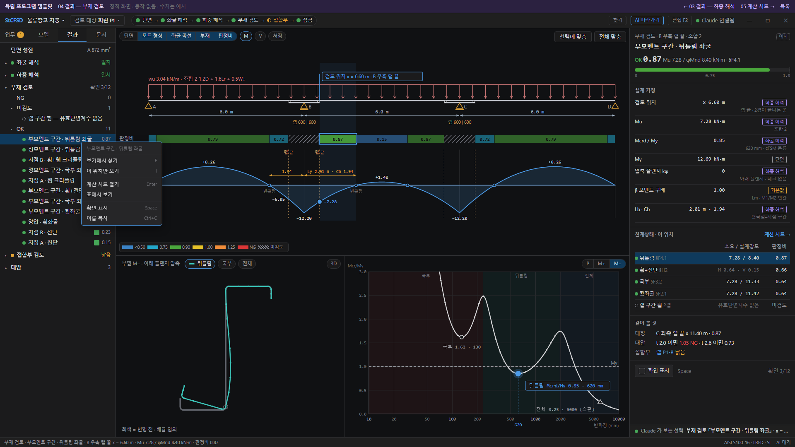

# StCFSD 독립 프로그램 — 화면 템플릿

2026-11-22 · 상태: **제안**. 정적 화면 10장이다. 동작은 없고 제품 코드는 바꾸지 않았다.

`index.html` 을 브라우저로 연다. 지금 GUI 의 전수 조사는 [G2 인벤토리](../../docs/reviews/20261122-desktop-survey/G2-stcfsd-gui-inventory.md) §1 · §6 에 있다.



## 세 가지 약속

StAnal 템플릿과 같다.

1. **왼쪽은 트리다.** 탭 4개(업무 · 모델 · 결과 · 문서). 한 줄에 이름과, 오른쪽 끝에 개수 · 값 · 상태만 있다. 고르면 가운데 보기와 오른쪽이 따라온다.
2. **오른쪽은 읽는 곳이다.** 고른 것의 값 · 출처 · 근거 · 영향만 보인다. 선택지 단추, 요청 양식, 메모 칸이 없다. 답 · 수정 · 요청은 Claude Desktop 대화창에 말로 한다. 오른쪽 아래 한 줄 「Claude 가 보는 선택」이 지금 고른 것을 AI 가 「이거」로 읽을 수 있다는 표시다.
3. **설명은 풍선 도움말이다.** 화면에 안내 문장을 쓰지 않는다. 정지 화면에서는 `02-buckling.html` 의 「cFSM 분류」 한 곳만 펼쳐 두었다.

화면에 남긴 단추는 사람만 하는 일뿐이다: 확인 표시, 발행, 편집 상태(F2), Claude 「연결」.

## 창의 틀

```
┌ StCFSD · 물류창고 지붕 ▾ · 검토 대상 퍼린 P1 ▾ · 단면 ● → 좌굴 해석 ● → 하중 해석 ● → 부재 검토 ● → 접합부 ◐ → 점검 ● ··· 찾기 · AI 따라가기 · 편집 F2 · ● Claude 연결됨 ┐
├ (AI 작업 중일 때만) AI 띠 · (편집 상태일 때만) 이번 편집 — 바뀐 것 3 ──────────────────────────────────────────────────┤
├──────────────────┬─────────────────────────────────────────────┬────────────────────┤
│ 업무│모델│결과│문서 │ 보기 칩: 단면 · 모드 형상 · 좌굴 곡선 · 부재 · 판정비 │ 정보                │
│ ▾ 부재 검토 3/12  │ ┌ 그림 1 (예: 부재 보기 + 판정비 띠) ┐           │  이름 · 판정         │
│   ▾ OK       11  │ └ 그림 2 (예: 단면 + 모드 / 좌굴 곡선) ┘         │  값과 출처           │
│     …뒤틀림  0.87 ├─────────────────────────────────────────────┤  근거 · 영향          │
│ 280px            │ 표 (접을 수 있음)                              │ Claude 가 보는 선택   │
├──────────────────┴─────────────────────────────────────────────┴────────────────────┤
│ 상태 표시줄 — 고른 것 · AISI S100-16 · LRFD · SI · AI 대기                                  │
└────────────────────────────────────────────────────────────────────────────────┘
```

| 탭 | 가지 |
|---|---|
| 업무 | 판단 요청 · 보고 · 변경 · 점검(실패 · 주의 · 통과) |
| 모델 | 단면(치수 · 절점 · 요소 · 스프링 · 구속) · 재료 · 부재(스팬 · 지점 · 랩 · 간격 · 데크) · 하중(+ 조합) · 설계 조건 · 접합부 · 가정 |
| 결과 | 단면 성질 · 좌굴 해석(P · M+ · M− 의 국부 · 뒤틀림 · 전체, 모드 분류, 소성 곡면, 진동) · 하중 해석 · 부재 검토(NG · 미검토 · OK, 줄 = 위치 · 한계상태) · 접합부 검토 · 대안 |
| 문서 | 계산서 · 좌굴 해석 보고서 · 검증표 · 원자료 · 발행 |

1100px 보다 좁은 창에서는 트리가 접히고 보기와 정보만 남는다. 진행 띠는 짧은 이름(단면 · 좌굴 · 하중 · 검토 · 접합 · 점검)으로 줄어든다. `shots/04-checks-960.png`.

### 진행 띠

제목 줄의 `단면 ● → 좌굴 해석 ● → …` 는 결과가 지금 입력과 맞는지를 보인다. ● 일치 · ◐ 낡음(입력이 바뀐 뒤 다시 돌리지 않음) · ○ 실행 안 함 · 파란 점 실행 중. 순서를 막는 길잡이가 아니다. 누르면 트리의 그 가지를 고른다. 풍선 도움말에 실행 시각과 낡은 까닭이 있다.

### 값의 출처

오른쪽의 설계 가정 줄마다 출처 표시가 붙는다. 엔진 검토에서 가장 큰 위험이 「조용한 기본값」이었기 때문이다.

| 표시 | 뜻 |
|---|---|
| `기본값` (주황 테) | 입력 기본값이 그대로 쓰였다. 아무도 정하지 않았다 |
| `AI` · `사용자` | AI 가 정했다 · 사람이 정했다 |
| `하중 해석` · `좌굴 해석` (보라 테) | 다른 결과에서 자동으로 나왔다. 옆에 까닭 (예: 「변곡점–지점 구간」) |
| `단면` | 단면 성질에서 나왔다 |
| `자체 가정` (주황 테) | 기준 조항이 아닌 자체 해석. 판단 요청에 걸려 있다 |

모델 탭의 「가정」 가지가 이것들을 모은 목록이다.

## 우클릭 메뉴

템플릿에서 실제로 뜬다(누르는 것까지만). `01` · `03` · `04` 에는 펼친 모습을 그려 두었다.

| 어디서 | 메뉴에 있는 것 |
|---|---|
| 트리 · 한계상태 | 보기에서 찾기, 이 위치만 보기, 계산 시트 열기 (Enter), 표에서 보기, 확인 표시 (Space), 이름 복사 |
| 트리 · 모델 값 | 출처 보기, 표에서 보기, 복사 |
| 트리 · 업무 · 변경 · 문서 · 대안 | 대상 보기 · 바뀐 곳 보기 · 열기 · 비교 같은 보는 일과 확인 표시 |
| 보기의 빈 곳 | 전체 맞춤, 표시 항목, 그림 복사 |
| 표의 줄 | 보기에서 찾기, 행 복사, CSV |

메뉴에는 **보는 일**과 사람만 하는 **확인 표시**만 있다. 값 바꾸기, 다시 실행, 대안 만들기는 메뉴에 없다. 그것은 Claude 에게 말로 한다.

## StAnal 에서 가져온 것과 다른 것

| | StAnal | StCFSD |
|---|---|---|
| 창 틀 · 어두운 테마 · 트리 탭 4개 · 오른쪽 정보 창 · 「Claude 가 보는 선택」 · 풍선 도움말 · 우클릭 메뉴 · 좁은 창 규칙 | 그대로 | 가져옴. `review.css` · `app.css` 는 StAnal 의 것을 바꾸지 않고 복사했다 |
| 가운데 | 3D 골조 | **보기**: 지금 제품에 있는 그림을 다시 짠 것. 단면 보기(치수 · 절점 · 요소 · 주축 · 응력 · 모드 형상), 좌굴 곡선(반로그, 국부 · 뒤틀림 극소 표시), 부재 보기(보 개략도 · 하중 · 랩 · M · V · 처짐 · 비지지 길이 · 판정비 띠), 접합 도면(측면도 · Cut A-A · 패스너 배치). 보기 칩으로 둘을 골라 위아래로 놓는다 |
| 작업 단위 | 프로젝트 · 안(기존안 · 보강안) | 검토 대상 하나 = `.csd` 하나 (단면 + 부재 조건 + 하중 + 검토). 제목 줄의 선택기 |
| 결과의 최신 여부 | 「해석 #7 과 일치」 한 줄 | 진행 띠 6단계. 결과끼리 기대기 때문 (단면 → 좌굴 → 검토, 하중 → 검토 → 접합부) |
| 값의 출처 | 기본값 · AI · 사용자 | + 하중 해석 · 좌굴 해석(까닭과 함께) · 단면 · 자체 가정 |
| 계산 시트 | 엔진이 남기지 않는 값은 보라 점선 칸 | 엔진이 식 번호 · 대입 값을 남기므로 실제 단계를 편다. 구현되지 않은 조항만 「미검토 — 까닭」 |
| 편집 상태 (F2) | 3D 위에 그리기 도구 | 지금의 6탭 입력 화면(① 단면·재료 ② 하중계산 ③ 좌굴해석·부재설계 ④ 접합부 · 보고서 · 검증)을 가운데 + 오른쪽 자리에 연다. 틀은 그대로, 「편집」 표시와 「이번 편집 — 바뀐 것 3」 띠 |

## 화면

모든 화면이 같은 검토 대상 하나를 보인다: 지붕 퍼린 P1 — 립 Z-200×75×20×2.3 (r 4), SGC400 (Fy 245 · Fu 400 MPa), 3연속 스팬 6.0 m, 간격 1.2 m, 랩 600/600, 관통 체결 데크, D 0.30 · Lr 1.00 · S 0.50 · W↑ 1.00 · W↓ 1.00 kPa, LRFD, SI.

| 파일 | 탭 · 고른 것 | 가운데 | 오른쪽 |
|---|---|---|---|
| `00-start.html` | (시작) | 최근 검토(진행 띠 축소판) · 새 검토 · Claude 「연결」 세 단계 | — |
| `01-section.html` | 모델 · 단면 | 단면 보기(치수 H B D t r · 절점 · 요소 · 주축), 표에 절점 · 요소. 모델 값 우클릭 메뉴 | 종류 · 치수와 출처, 단면 성질, 요소 분할 |
| `02-buckling.html` | 결과 · 좌굴 해석 · 정휨 M+ · 뒤틀림 | 위: 단면 + 뒤틀림 모드(응력 분포, 모드 3개 축소판), 아래: 좌굴 곡선 | Mcrd · 반파장 · My · Mcrd/My, 모드 분류 G/D/L/O, 식별 방법, 해석 조건과 출처, 경고, 쓰이는 곳 |
| `03-loads.html` | 결과 · 하중 해석 · 지배 조합 | 부재 보기: 하중 · 랩 · M · V · 처짐 · 변곡점 · Ly · Cb, 표에 위치 9 의 Mu · Vu · Ru. 빈 곳 우클릭 메뉴 | 조합식, 패턴 재하, 자동으로 정한 값(Lb · Cb · R · kφ)과 근거, 처짐 L/δ |
| `04-checks.html` | 결과 · 부재 검토 · 부모멘트 구간 · 뒤틀림 좌굴 | 위: 부재 보기 + 판정비 띠(고른 구간 강조), 아래: 단면 + 부휨 모드 · 좌굴 곡선. 트리 줄 우클릭 메뉴 | 판정 0.87, 설계 가정과 출처, 이 위치의 한계상태, 같이 볼 것, 확인 표시 |
| `05-sheet.html` | 같은 선택 · 계산 시트 | 보기는 좁아지고 시트가 옆에: 1 부재와 가정, 2 소요강도, 3 한계상태별 계산(식 · 대입 · 결과 · 조항), 「미검토 — 까닭」 | (시트) |
| `06-connection.html` | 결과 · 접합부 검토 · 랩 P1-B | 랩 도면: 측면도(랩 · 볼트 · 클리트 · 짝힘) · Cut A-A · 패스너 배치 | 패스너 DCR, 랩 구간 휨 DCR, 한계상태, 「힘 분배는 기준 조항이 아닌 자체 해석」 알림 줄, 입력과 출처 |
| `07-work.html` | 업무 · 변경 (AI 작업 중, 10:12 시점) | 단면 보기에 t 2.0 → 2.3 강조 · 상세 ×20, 표에 바뀐 값 | 누가 · 왜, 바뀐 것(전 → 후), 영향(좌굴 해석 실행 중 · 나머지 낡음) |
| `08-documents.html` | 문서 · 계산서 | 쪽 미리보기(3장 좌굴 해석 · 4장 부재 검토표) | 상태, 발행을 막는 것, 경고, 묶이는 것, 「R0 발행」(꺼짐) |
| `09-edit.html` | 모델 · 편집 상태 | 6탭 입력 화면(② 하중계산)이 가운데 + 오른쪽 자리에 | — |

## 파일

- `assets/shell.js` — 제목 표시줄(진행 띠), 왼쪽 트리(내용은 `trees()`), 우클릭 메뉴(`MENUS`), 풍선 도움말, 가운데 그림 네 가지(`secView` · `curveView` · `memberView` · `lapView`)와 절점 · 요소 표. 화면 파일은 `#page` 의 `data-tab` · `data-sel` · `data-share` · `data-pipe` 와 가운데 · 오른쪽만 가진다. 그림 자리는 `data-draw` · `data-opt`.
- `assets/review.css` · `assets/app.css` — StAnal 템플릿에서 그대로 복사. `assets/cfsd.css` — 진행 띠, 출처 표시, 그림 자리, 편집 상태 입력 화면.
- `shots/` — 1920×1080 (헤드리스 Edge) 그림. `04-checks-960.png` 는 960 px 창.

### 수치

**모든 수치는 예시다.** 점선 「예시」 표시를 화면마다 붙였다. 다만 서로 맞게 지었다: 단면 성질(A 872 mm², Sx 51.8×10³ mm³, My 12.69 kN·m)에서 DSM 뒤틀림 강도(Mcrd/My 0.85 → Mnd 9.33 → φMnd 8.40 kN·m)를 계산했고, 조합 2(wu 3.04 kN/m)의 3연속 보 M · V · 처짐은 그림과 표가 같은 식에서 나온다(지점 B −12.20, B 우측 랩 끝 −7.28, 스팬 1 +8.26 kN·m, 처짐 L/475). 지점 모멘트를 랩 강성으로 약간 키운 것은 그림을 위한 가정이다. 좌굴 곡선 · 모드 형상은 엔진 결과가 아니라 모양을 보이기 위한 근사다.

## 다루지 않은 것

- 압축 · 조합 부재(스터드), 인장 부재의 화면 — 부재 보기와 한계상태 표는 같은 틀이다
- 소성 곡면 · 진동 · 모드 분류 곡선의 보기 칸 (트리에 줄만 있다)
- 단일 접합부(나사 · 볼트 · 용접 7종) 도면
- 3D 모드 형상 보기 (「3D」 칩만 있다)
- 원자료(도면 PDF)를 여는 보기 칸, 메뉴 막대, 단축키 전체 목록, 설정, 단위 전환(US/SI)의 화면
- 밝은 테마의 점검 (화면은 `data-theme="dark"` 로 고정해 그렸다)
