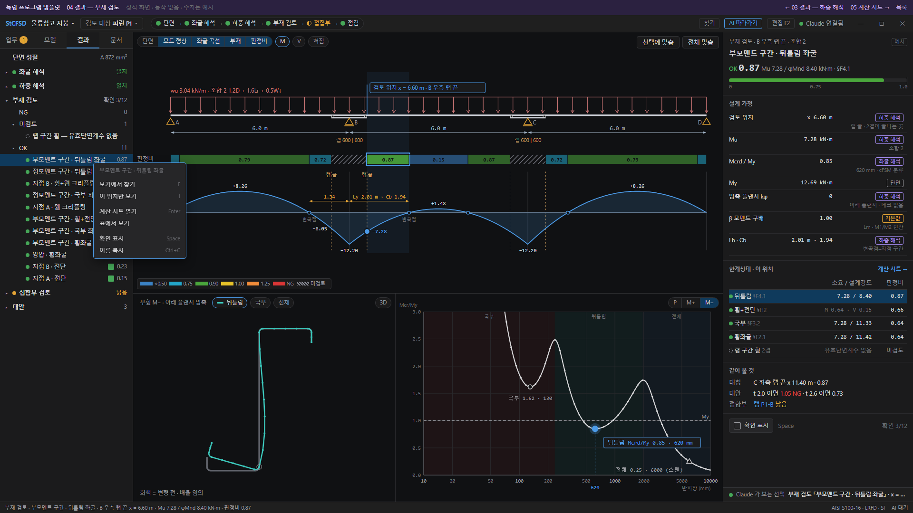

# StCFSD 독립 프로그램 — 인터페이스 구성안

2026-11-22 · 상태: **승인(2026-11-22)** — 9장의 결정은 권장대로. 구현은 7장의 순서로 간다(S1 · K1 부터). 진행은 작업문서 3.2절에 있다.

- 진행: [작업문서](20261122-desktop-program-worklog.md)
- 근거가 된 조사: [StAnal `desktop/` 조사](../reviews/20261122-desktop-survey/G1-stanal-desktop.md) · [StCFSD 지금 화면 목록](../reviews/20261122-desktop-survey/G2-stcfsd-gui-inventory.md) · [경계층 리뷰](../reviews/20261122-engine-review/R8-boundary-layer.md)
- 화면 템플릿: [`desktop/design/`](../../desktop/design/README.md) — `desktop/design/index.html` 을 브라우저로 연다
- 본뜬 것: StAnal 의 방향 문서 `docs/implementation/20261121-project-collaboration-direction.md` 와 작업문서 `docs/implementation/20261122-desktop-program-worklog.md` (`C:\Coding_Works\StAnal`, 브랜치 `fix/full-code-review-20261119`, 커밋 `c9582d8a`)

---

## 0. 결론

1. **StAnal 과 같은 틀로 간다.** 저장소 안의 `desktop/` 에서 만들고(`design` · `host` · `ui` · `shell` · `installer`), VS Code 확장은 그대로 둔다. 계산 · 모델 · MCP 코드는 한 벌이다. 확장 호스트 번들을 `vscode` 대체 모듈 위에서 그대로 돌린다 — StCFSD 가 쓰는 VS Code API 는 StAnal 의 대체 모듈에 이미 다 있다.
2. **화면은 입력 양식에서 검토 화면으로 바꾼다.** 대화는 Claude Desktop 에서만 한다. StCFSD 창은 왼쪽 트리(업무 · 모델 · 결과 · 문서), 가운데 보기, 오른쪽 정보 창이다. 지금의 탭 6개짜리 입력 화면은 없애지 않고 「편집 상태(F2)」로 남긴다.
3. **StAnal 과 다른 점이 셋 있다.**
   - 가운데가 3D 골조가 아니라 **단면 · 좌굴 곡선 · 부재(하중도) · 접합 도면**을 겹쳐 쌓는 「보기」다.
   - 결과가 서로 기대므로(단면 → 좌굴 해석 → 하중 해석 → 부재 검토 → 접합부) **무엇이 최신이고 무엇이 낡았는지**를 보이는 진행 띠를 둔다.
   - 엔진 리뷰에서 가장 큰 위험이 "조용한 기본값"이었다. 그래서 **값의 출처**(기본값 · AI · 사용자 · 하중 해석에서 자동)를 화면의 한가운데에 둔다.
4. **화면보다 먼저 고칠 것이 있다.** StAnal 은 상태와 로직이 전부 호스트에 있었다. StCFSD 는 설계 입력이 화면(DOM)에만 있고, 검증 70항목과 보고서도 화면의 JS 에서만 만들어진다. "Claude 가 일하고 화면이 따라간다"가 되려면 이것을 호스트의 공용 코드로 옮겨야 한다(4장).
5. **MCP 연결은 제품 코드를 고쳐야 한다.** 지금은 고정 포트 · 토큰 없음 · `node` 명령 등록 · Claude Desktop 미등록이다. 포트 파일 + 토큰, 프로그램 실행 파일로 MCP 서버 돌리기, 「연결」 단추로 바꾼다(2.3절).
6. 진행은 네 갈래다. **형태**(창 · 연결 · 설치 파일) → **공용 코어**(상태와 로직을 호스트로) ∥ **화면**(새 화면) → **기록**(프로젝트 · 변경 · 가정 · 확인 · 발행). 형태 갈래가 끝나면 지금 화면 그대로 직원 PC 에 깔 수 있다(7장).

사용자가 정할 것은 9장에 모았다.

---

## 1. 지금 무엇이 걸리나

조사에서 확인한 사실이다. 줄 번호와 근거는 조사 보고서에 있다.

| 지금 | 독립 프로그램에서 왜 문제인가 |
|---|---|
| 모델과 결과는 호스트의 패널 객체가 갖는다. **패널을 닫으면 사라지고 MCP 도구 59개 중 58개가 실패**한다 | 독립 프로그램은 창이 곧 프로그램이라 패널을 닫을 일이 없다. 대체 모듈이 패널을 시작할 때 만들고 닫지 않으면 풀린다 |
| 설계 · 하중 · 접합 **입력값이 화면의 DOM 에만** 있다 | Claude 가 MCP 로 설계를 돌리면 결과는 화면에 오지만 입력 칸은 그대로다 — 화면의 입력과 결과가 어긋난다. 누가 무엇을 바꿨는지 기록할 수도 없다 |
| MCP 로 정한 경계조건 · 길이 · 하중 케이스가 화면 입력 칸에 반영되지 않는다. 화면에서 「해석 실행」을 누르면 덮어쓴다 | 사람과 AI 가 번갈아 일하면 서로의 설정을 지운다 |
| **검증 70항목 · 상세 보고서 · PDF · 좌굴 보고서가 화면의 JS 에서만** 만들어진다. MCP `validate_design` 은 항목이 비어 있고 `generate_report` 는 JSON 만 준다 | Claude 에게 "검증하고 계산서 초안 만들어 줘"라고 할 수 없다 |
| MCP 결과 중 화면에 오지 않는 것이 많다(하중 해석, 진동, 웹 크리플링 단독 등) | AI 가 한 일이 화면에 보이지 않는다 |
| MCP 다리: 고정 포트 52790 – 52809, 인증 없음, CORS `*`, `save_project` 가 아무 경로에나 쓴다 | 보안 결함(R8-09). 같은 PC 의 아무 웹 페이지나 조종할 수 있다 |
| MCP 등록이 `.mcp.json` · `~/.claude/mcp.json` 뿐이고 실행 명령이 `node` | Claude Desktop 에 붙지 않는다. 직원 PC 에는 Node 가 없다 |
| MCP 서버 안내문이 좌굴 해석 6단계만 말한다 | AI 가 설계 · 하중 · 접합 · 검증 흐름을 안내문에서 배우지 못한다 |
| 화면이 탭 6개의 입력 양식. FSM 해석과 하중 해석이 독립된 두 갈래인데 탭 순서가 이를 가린다. 결과가 탭마다 흩어져 있다 | 검토하는 사람이 "지금 어디까지 됐고 무엇이 지배하는가"를 한눈에 볼 수 없다 |
| `.csd` 에 입력 9개와 랩 결과가 저장되지 않는다 | 다시 열면 일부가 기본값으로 돌아간다 |

**엔진 수정 묶음 2(2026-11-22)에서 이미 풀린 것.** 위 표는 조사 시점의 모습이다. 구성안을 기다리지 않고 고칠 수 있는 것은 엔진 리뷰의 경계층 수정에서 고쳤다.

| 위 표의 줄 | 지금 |
|---|---|
| MCP 다리의 보안 | CORS 허용을 없앴고, `Origin` 머리 · JSON 아닌 요청 · 다른 `Host` 를 거절한다. 토큰과 포트 파일은 아직(K1) |
| MCP 서버 안내문 | 전체 흐름(단면 → 좌굴 해석 → 하중 해석 → 부재 검토 → 접합부 → 검증 · 보고서), 단위, 자체 가정을 사용자에게 알리라는 것까지 다시 썼다 |
| `.csd` 에 빠진 입력 | 1.3 판 — 입력 전부와 랩 결과를 담는다. 옛 엔진이 계산한 결과는 열 때 버리고 다시 실행을 안내한다 |
| 화면 경로와 MCP 경로가 다른 계산 | 부재 설계 · 퍼린 설계 · DSM 준비가 호스트의 한 함수를 탄다. 같은 입력이면 같은 답 |
| MCP 가 지어내던 기본값, SI | 기본값을 없앴고, 도구 41개가 SI 를 받고 중첩 결과까지 변환한다 |
| 낡은 결과 | 결과가 무효가 되면 화면의 모든 결과 영역을 지운다(AI 가 MCP 로 단면을 바꿀 때 포함) |

남은 것: 패널이 곧 상태인 구조, 설계 입력이 DOM 에만 있는 것, 검증 · 보고서가 화면의 JS 에서만 만들어지는 것, MCP 결과 일부가 화면에 오지 않는 것, 포트 · 토큰 · 등록, 화면의 모양. 4장의 K1 – K4 가 이것이다.

**띄워 본 증거.** 묶음 2 의 검증에서, 컴파일된 호스트를 `vscode` 대역 위에서 Node 로 돌리고(`test/webview/panel_harness.js`), 지금의 웹뷰를 헤드리스 Edge 에 띄워 실제 호스트 · 실제 파이썬과 이어 조작했다(`test/rendered/`, `npm run test:rendered`). 페이지 예외 0. **2.1절의 「호스트를 그대로 돌린다」와 「지금의 웹뷰를 통째로 끼워 넣는다」가 이 저장소에서 실제로 된다는 것을 이미 본 셈이다** — S1 · S2 는 이 하니스를 제품 모양(대체 모듈, HTTP 다리)으로 굳히는 일이다.

이미 갖춘 것도 있다. 바꾸지 않는다.

- 사람과 AI 가 같은 호스트 모델을 고친다. 낡은 결과는 모델 서명과 입력 리비전으로 걸러 쓰지 않는다.
- 엔진이 한계상태마다 **계산 단계(식 번호 · 대입값)를 이미 남긴다.** StAnal 이 따로 만들어야 했던 「계산 시트」의 재료가 여기에는 처음부터 있다.
- 판정이 OK / NG / 미검토 세 가지다.
- 그림 일습이 있다: 단면, 좌굴 곡선, 2D · 3D 모드 형상, G/D/L/O 분류, P-M 곡면, 보 개략도, M · V · 처짐도, 랩 도면, 접합 도면 7종.
- 지금 웹뷰는 VS Code 에 얕게 묶여 있다(`acquireVsCodeApi().postMessage` 하나와 `--vscode-*` 변수 37종). 독립 창에 그대로 띄우기 쉽다.

---

## 2. 구조

### 2.1 프로세스와 통로

```
Claude Desktop ──stdio── StCFSD.exe (ELECTRON_RUN_AS_NODE=1) media/mcp-server.js
                             │  %APPDATA%\StCFSD\mcp\stcfsd-mcp-port {port, token, pid} 를 읽는다
                             └─HTTP 127.0.0.1:<port> + Bearer 토큰─┐
                                                                   ▼
┌ StCFSD 독립 프로그램 (한 번만 실행) ──────────────────────────────────────┐
│ desktop/shell   Electron 창 · 파일 대화상자 · 창 위치 기억 · 포커스 안 가져감 │
│ desktop/host    vscode 대체 모듈 + 적재기 + 화면 다리(HTTP)                 │
│                  └ out/extension.js  (지금의 확장 호스트 그대로)             │
│                      └ StcfsdPanel(모델 · 결과) · MCP 다리 · PythonBridge   │
│ desktop/ui      새 화면 (트리 · 보기 · 정보 · 표)                           │
│                  └ <iframe> 지금의 웹뷰  (편집 상태에서만 보인다)            │
└────────────────────────────────────────────────────────────────────────┘
                             └ 묶어 넣은 python.exe ── python/server.py (numpy · scipy)
```

- **호스트는 고치지 않고 그대로 돌린다.** `vscode` 를 쓰는 파일은 `extension.ts` · `StcfsdPanel.ts` · `ProjectExplorerProvider.ts` 셋뿐이고, 쓰는 API 는 StAnal 의 대체 모듈(14 파일 1,831줄)에 전부 있다. 대체 모듈이 시작할 때 `stcfsd.openDesigner` 를 실행해 패널을 만들고 닫지 않는다 — "패널을 닫으면 상태가 사라진다"가 제품 코드를 고치지 않고 풀린다.
- **화면 다리는 HTTP(127.0.0.1 + 토큰)다.** Electron 전용 통로를 쓰지 않는다. 같은 화면을 보통 브라우저로 띄워 자동으로 그려 보고 시험할 수 있다.
- **새 화면은 AI 와 같은 길로 읽는다.** 화면 다리가 호스트의 MCP 경로를 그대로 부른다. 화면이 보는 값과 AI 가 보는 값이 같다. 호스트 → 웹뷰 메시지(모델, 해석 완료, 설계 결과, 트리 요약)는 다리가 지나가는 것을 함께 읽는다.
- **지금의 웹뷰는 통째로 끼워 넣는다.** 웹뷰 HTML 을 내줄 때만 자원 주소 · CSP · `acquireVsCodeApi` 대역 · 테마 변수 37종을 바꿔 넣는다. 확장의 웹뷰는 한 글자도 바뀌지 않는다.
- **Python 은 묶어서 낸다.** 의존성이 numpy · scipy 둘뿐이라 StAnal(186.7 MiB)보다 작다.

### 2.2 디렉토리와 규칙

```
cufsmAi/
├─ src/  webview/  python/  media/  test/        ← 지금 그대로. 확장이 여기서 빌드된다
└─ desktop/
   ├─ design/      화면 템플릿 (지금 있는 것)
   ├─ host/        vscode 대체 모듈 · 적재기 · 화면 다리 · Claude 연결
   ├─ ui/          새 화면
   ├─ shell/       Electron 창 (자체 package.json)
   └─ installer/   Windows 설치 파일 · Python 묶음
```

StAnal 의 여섯 규칙을 그대로 쓴다.

1. `desktop/` 에 두는 것은 껍데기와 화면뿐이다. 엔진, 설계 로직, MCP 도구는 복사해 오지 않는다. 복사하면 같은 단면이 두 프로그램에서 다른 값을 낼 수 있다.
2. 의존은 한 방향이다. `desktop/` 이 나머지를 쓰고, 확장은 `desktop/` 을 쓰지 않는다.
3. 확장 호스트는 떼어 내지 않고 그대로 돌린다. 독립 프로그램만을 위한 갈래를 `src/` 에 만들지 않는다 — 4장의 공용 코어 작업은 확장에도 똑같이 들어가는 공용 코드다.
4. 확장의 화면(`webview/`)은 동작을 바꾸지 않는다. 새 화면은 `desktop/ui/` 에 새로 짓는다.
5. `desktop/` 은 확장 배포물에 들어가지 않는다(`.vscodeignore`).
6. 단계마다 지금의 시험(파이썬 · 웹뷰 계약 · tsc · eslint · MCP 패리티)을 다시 돌린다.

### 2.3 Claude Desktop 연결

| | 지금 | 바꾼 뒤 |
|---|---|---|
| MCP 서버를 띄우는 명령 | `node media/mcp-server.js` | `StCFSD.exe media/mcp-server.js` + `ELECTRON_RUN_AS_NODE=1` (Node 를 깔 필요 없음) |
| 호스트를 찾는 법 | 설정 파일의 `env.STCFSD_MCP_PORT`(시작할 때 한 번) | 환경 변수 `STCFSD_MCP_PORT_FILE` 이 가리키는 포트 파일 `{port, token, pid}` — 호출마다 읽는다 |
| 인증 | 없음, CORS `*` | Bearer 토큰, CORS 없음, content-type 검사 |
| 프로그램을 껐다 켜면 | Claude 를 다시 시작해야 한다 | 다시 붙는다. 재시작 뒤 첫 호출은 `get_status` 만 통과시키고(알림을 붙여), 성공할 때까지 다른 호출은 거절한다 |
| 프로그램이 꺼져 있으면 | `ECONNREFUSED` | "StCFSD 프로그램이 실행 중이 아닙니다. 사용자에게 StCFSD 를 켜 달라고 하세요" |
| 등록 | `.mcp.json`, `~/.claude/mcp.json` | 「연결」 단추 → `%APPDATA%\Claude\claude_desktop_config.json` 의 `mcpServers.stcfsd`. 쓰기 전에 백업, 임시 파일 + 이름 바꾸기, 다시 읽어 확인. 깨진 JSON 은 건드리지 않는다. 끊기는 자기가 쓴 항목만 지운다 |
| 연결 상태 | 보이지 않는다 | 제목 표시줄에 「Claude 연결됨 / 등록됨 · 아직 호출 없음 / 등록 안 됨」과 마지막 호출 |

환경 변수가 없으면 지금의 방식 그대로 돈다 — 확장의 연결은 바뀌지 않는다.

---

## 3. 화면

### 3.1 세 가지 약속 (StAnal 과 같다)

1. **왼쪽은 트리다.** 탭 4개(업무 · 모델 · 결과 · 문서). 한 줄에 이름과 오른쪽 끝의 개수 · 값 · 상태만 있다. 고르면 가운데와 오른쪽이 따라온다.
2. **오른쪽은 읽는 곳이다.** 고른 것의 값 · 출처 · 근거 · 영향만 보인다. 선택지 단추, 요청 양식, 메모 칸이 없다. 답 · 수정 · 요청은 Claude Desktop 에 말로 한다. 오른쪽 아래 한 줄 「Claude 가 보는 선택」이 지금 고른 것을 AI 가 읽을 수 있다는 표시다.
3. **설명은 풍선 도움말이다.** 화면에 안내 문장을 쓰지 않는다.

화면에 남는 단추는 사람만 하는 일뿐이다: 확인 표시, 발행, 편집 상태(F2), Claude 「연결」.

### 3.2 창의 틀

```
┌ StCFSD · 물류창고 지붕 ▾ · 검토 대상 퍼린 P1 ▾ · LRFD · SI ········ 찾기 · AI 따라가기 · 편집 F2 · ● Claude 연결됨 ┐
│ 단면 ● → 좌굴 해석 ● → 하중 해석 ● → 부재 검토 ● → 접합부 ◐ → 점검 ●                                       │
├──────────────────┬────────────────────────────────────────────┬──────────────────────┤
│ 업무│모델│결과│문서 │ [단면] [모드 형상] [좌굴 곡선] [부재] [판정비]   │ 정보                  │
│ ▾ 부재 검토  3/12 │  ┌ 보기 ─────────────────────────────────┐ │  이름 · 판정          │
│   NG          0  │  │ 단면 + 모드 형상                        │ │  설계 가정과 출처      │
│   ▾ 미검토     1  │  ├────────────────────────────────────────┤ │  한계상태 표          │
│   ▾ OK       11  │  │ 좌굴 곡선 / 부재 · 하중도                │ │  근거 · 경고          │
│     부모멘트 구간  │  └────────────────────────────────────────┘ │                      │
│     · 뒤틀림 0.87 ├────────────────────────────────────────────┤                      │
│ 280px            │ 표 (접을 수 있음)                            │ Claude 가 보는 선택    │
├──────────────────┴────────────────────────────────────────────┴──────────────────────┤
│ 상태 표시줄                                                                             │
└───────────────────────────────────────────────────────────────────────────────────┘
```

- **일의 단위는 검토 대상 하나**(`.csd` 파일 하나 = 단면 + 부재 조건 + 하중 + 검토)다. 제목 표시줄에서 고른다.
- **창은 포커스를 가져가지 않는다.** 사람은 다른 모니터의 Claude Desktop 에 글을 쓰고 있다.
- 1100px 보다 좁은 창에서는 트리가 접히고 보기와 정보만 남는다.

### 3.3 진행 띠 — 무엇이 최신인가

StCFSD 의 결과는 줄줄이 기댄다. 두께 하나를 바꾸면 좌굴 해석, 부재 검토, 접합부가 모두 낡는다. 호스트는 이미 모델 서명과 입력 리비전으로 이것을 안다. 그것을 한 줄로 보인다.

`단면 ● → 좌굴 해석 ● → 하중 해석 ● → 부재 검토 ● → 접합부 ◐ → 점검 ●`

● 입력과 일치 · ◐ 낡음(그 뒤로 입력이 바뀜) · ○ 아직 안 함. 누르면 트리의 그 가지로 간다. 단계를 막는 장치가 아니라 상태 표시다. 낡은 결과는 지금처럼 그리지 않거나 낡음 표시와 함께 흐리게 그린다.

0926 문서가 제안했던 "단계형 위저드"를 이것이 대신한다. 입력을 사람이 차례로 하는 것이 아니라 Claude 가 하므로, 필요한 것은 단계 안내가 아니라 상태다.

### 3.4 왼쪽 트리

| 탭 | 가지 | 고르면 |
|---|---|---|
| 업무 | 판단 요청 · 보고 · 변경 · 점검(검증 항목: 실패 · 주의 · 통과) | 보기에 그 대상이 강조되고 오른쪽에 내용과 근거 |
| 모델 | 단면(치수 · 절점 · 요소 · 스프링 · 구속) · 재료 · 부재(스팬 · 지점 · 랩 · 간격 · 데크) · 하중(케이스 · 조합) · 설계 조건(설계법 · 비지지 길이 · Cb · 웹 크리플링 조건 · 옵션) · 접합부 · 가정 | 보기에 그 부분이 강조되고 오른쪽에 값과 출처 |
| 결과 | 단면 성질 · 좌굴 해석(압축 · 정휨 · 부휨 → 국부 · 뒤틀림 · 전체, 모드 분류, 소성 곡면, 진동) · 하중 해석(조합 · 위치 · 처짐) · 부재 검토(NG · 미검토 · OK) · 접합부 검토 · 대안 | 보기에 결과, 오른쪽에 판정과 근거 |
| 문서 | 계산서 · 좌굴 해석 보고서 · 검증표 · 원자료 · 발행 | 가운데에 문서 미리보기 |

- 「부재 검토」의 한 줄은 **위치 · 한계상태**다(예: `부모멘트 구간 · 뒤틀림 좌굴 0.87`, `지점 B · 휨 + 웹 크리플링 0.74`). 미검토는 합격과 다른 모양으로 따로 센다.
- 「가정」은 기본값으로 채운 입력, AI 가 가정한 것, 기준에 없는 자체 해석(예: 랩 패스너의 힘 분배)을 모은다.
- 지금의 탭 6개와의 대응: ① 단면 · 재료 → 모델의 단면 · 재료, ② 하중계산 → 모델의 부재 · 하중 + 결과의 하중 해석, ③ 좌굴해석 · 부재설계 → 모델의 설계 조건 + 결과의 좌굴 해석 · 부재 검토, ④ 접합부 → 모델의 접합부 + 결과의 접합부 검토, 보고서 → 문서, 검증 → 업무의 점검. 트리의 26개 이동 대상도 이 가지들로 들어간다.

### 3.5 가운데 「보기」

StAnal 의 3D 자리다. 3D 골조가 아니라 제품에 이미 있는 그림을 겹쳐 쌓는다.

| 그림 | 내용 | 지금 코드 |
|---|---|---|
| 단면 | 축척대로 그린 단면, 치수(H · B · D · t · r), 절점 · 요소, 응력 분포 | `renderSectionSVG` (새로 그림 — 110줄) |
| 모드 형상 | 변형 전 단면 위에 좌굴 모드. 「3D」로 바꾸면 Babylon 렌더러 | 2D 는 새로, 3D 는 `ModeShape3DRenderer` 클래스를 그대로 쓴다(순수) |
| 좌굴 곡선 | 반로그 시그니처 곡선, 국부 · 뒤틀림 극소 표지, 고른 것 강조 | `renderBucklingCurve` (새로 그림 — 250줄) |
| 부재 | 보 개략도(스팬 · 지점 · 랩 · 하중) + M · V · 처짐도, 비지지 길이 치수선, 위치별 판정비 띠 | `renderBeamSchematic` · `renderDiagramSVG` (새로 그림) + 판정비 띠는 새것 |
| 접합 도면 | 랩 측면도 + Cut A-A, 단일 접합 7종 | `_drawLapSvg` · `_drawConnectionSvg` 를 옮긴다 |
| 그 밖 | G/D/L/O 분류 막대, P-M 곡면 | `_drawPMChart` 를 옮긴다 |

- 왼쪽 위의 보기 단추(단면 · 모드 형상 · 좌굴 곡선 · 부재 · 판정비)로 구성을 고른다. 보통 둘을 위아래로 쌓는다(단면 + 모드 형상 / 좌굴 곡선).
- **그림은 `desktop/ui/` 에 새로 그린다**(데이터 → SVG 의 순수 함수). 지금의 그림 코드는 `app.js` 의 전역 상태와 고정 DOM id 에 묶여 있어(`getElementById` 204곳) 떼어 내는 쪽이 확장에 더 위험하다. 그리는 코드만 두 벌이 되고, **계산은 두 벌이 되지 않는다** — 지금 화면의 JS 에 있는 계산(응력 미리보기의 간이 응력, 퍼린 지배 결과 고르기, 검증 규칙)은 4장에서 호스트로 옮겨 한 벌로 만든다.
- 표 서랍: 절점 · 요소, 곡선 데이터, 하중조합, 위치별 소요강도, 한계상태.

### 3.6 오른쪽 정보 창과 값의 출처

고른 것의 이름과 판정, 값, 근거, 경고를 보인다. 설계 가정에는 출처 꼬리표가 붙는다.

| 꼬리표 | 뜻 |
|---|---|
| `기본값` | 아무도 정하지 않아 프로그램이 채웠다. 가장 눈에 띄게 그린다 |
| `AI` | Claude 가 정했다. 이유가 있으면 함께 |
| `사용자` | 사람이 편집 상태나 값 고치기로 정했다 |
| `하중 해석` | 하중 해석에서 자동으로 나왔다. 근거 문구와 함께(예: "변곡점 – 지점 구간") |
| `단면` | 단면에서 나왔다 |
| `자체 가정` | 기준 조항이 아닌 자체 해석이다(A1.2(c)) |

한계상태를 고르면 「계산 시트」를 열 수 있다. 엔진이 남긴 계산 단계(조항 번호 · 식 · 대입 · 결과)를 그대로 그린다. 구현하지 않은 조항은 「미검토 — 까닭」으로 보인다. 숫자는 MCP 가 주는 값, 정보 창의 값, 계산서의 값과 같다.

### 3.7 사람이 하는 일과 말로 하는 일

| 일 | 어디서 | StCFSD 가 하는 것 |
|---|---|---|
| 단면 · 하중 · 조건을 바꾸기, 다시 해석하기, 대안 만들기 | Claude Desktop 에 말로 | 지금 값과 출처, 바꾸면 무엇이 낡는지를 보인다 |
| 판단 요청에 답하기 | Claude Desktop 에 말로 | 질문과 근거를 보인다. AI 가 사용자의 말을 답으로 남기면 그대로 보인다 |
| "이거", "지금 보는 것" | — | 지금의 선택을 AI 가 읽게 한다(「Claude 가 보는 선택」) |
| 확인 표시 | StCFSD 에서 한 번 누르기 | 사람만 켠다. MCP 로는 못 쓴다 |
| 발행 | StCFSD 에서 단추 하나 | 사람만 한다. 막는 것이 있으면 꺼져 있다 |
| 손으로 직접 입력 · 해석 · 설계 | 편집 상태(F2) | 지금의 탭 6개 화면을 연다 |

우클릭 메뉴에는 **보는 일**만 있다(보기에서 찾기, 이 위치만 보기, 계산 시트, 표에서 보기, 복사)와 사람만 하는 확인 표시. 값 고치기 · 다시 해석 · 대안 만들기는 메뉴에 없다.

### 3.8 편집 상태 (F2)

StAnal 의 F2 는 3D 에 그리기 도구를 연다. StCFSD 의 F2 는 **지금의 입력 화면(탭 6개)을 가운데와 오른쪽 자리에 연다.** 틀(제목 표시줄 · 트리)은 그대로다. 손으로 하는 모든 일이 여기서 된다 — 입력 양식을 새로 만들지 않는다. 편집을 나올 때 바뀐 것을 한 묶음으로 남긴다.

편집 상태가 아닐 때는 끼워 넣은 웹뷰가 보이지 않는다(4장이 끝나기 전에는 웹뷰가 뒤에서 검증 · 보고서 생성을 맡는다).

### 3.9 화면이 움직이는 규칙

| 일어난 일 | 화면 |
|---|---|
| AI 가 모델을 바꿈 | 보는 자리는 바꾸지 않는다. **낡은 결과는 그 순간 화면에서 지우거나 낡음으로 표시한다** — 이전 단면의 판정이 새 단면 옆에 남으면 안 된다(묶음 2 의 검증에서 실제로 나온 P0 이다). 진행 띠에 낡음 표시, 「무엇이 바뀌었나 · 보기」 |
| AI 의 해석 · 검토가 끝남 | 화면을 바꾸지 않는다. 「AI 가 좌굴 해석을 마쳤습니다 · 보기」 |
| AI 가 "여기를 보세요"(`focus`)를 부름 | 「AI 따라가기」가 켜져 있고 사람이 5초 넘게 가만히 있고 편집 상태가 아니면 따라간다. 아니면 누를 수 있는 알림으로 쌓인다 |
| AI 가 화면 상태를 읽음 | 아무것도 바뀌지 않는다 |
| 사람이 편집 상태에서 실행한 해석 · 검토가 끝남 | 결과로 이어진다(지금과 같다) |

### 3.10 화면 템플릿

`desktop/design/` 에 정적 화면 10장이 있다. `desktop/design/index.html` 을 브라우저로 열면 서로 넘겨 볼 수 있고, 트리 탭 · 우클릭 메뉴 · 풍선 도움말은 실제로 뜬다(실행은 없다). 그림은 `desktop/design/shots/` 에 1920×1080 으로 떠 두었다. 한 검토 대상(지붕 퍼린 P1 — 립 Z 200×75×20×2.3, 3연속 6.0 m, 랩 600 / 600)으로 열 장이 한 이야기가 되게 그렸다. **수치는 예시다** — 엔진 출력이 아니다.



| 파일 | 탭 · 고른 것 | 가운데 | 오른쪽 |
|---|---|---|---|
| [`00-start`](../../desktop/design/shots/00-start.png) | (시작) | 최근 검토(작은 단면 그림 · 진행 띠), 새 검토, Claude 「연결」 세 단계 | — |
| [`01-section`](../../desktop/design/shots/01-section.png) | 모델 · 단면 | 축척대로 그린 단면 + 치수, 절점 · 요소 표 | 종류 · 치수와 출처, 단면 성질 |
| [`02-buckling`](../../desktop/design/shots/02-buckling.png) | 결과 · 좌굴 해석 · 정휨 · 뒤틀림 | 단면 + 모드 형상 + 기준 응력 / 좌굴 곡선 | Mcrd, 반파장, 분류 막대, 식별 방법, 해석 조건과 출처, 쓰이는 곳 |
| [`03-loads`](../../desktop/design/shots/03-loads.png) | 결과 · 하중 해석 · 지배 조합 | 보 개략도 + M · V · 처짐도, 위치별 소요강도 표 | 조합식, 자동으로 정한 값(Lb · Cb · R · kφ)과 근거, 처짐 |
| [`04-checks`](../../desktop/design/shots/04-checks.png) | 결과 · 부재 검토 · 「부모멘트 구간 · 뒤틀림 좌굴」 | 판정비 띠 + 모멘트도 / 단면 + 모드 + 곡선 | 판정, 설계 가정과 출처, 이 위치의 한계상태 표, 같이 볼 것, 확인 표시 |
| [`05-sheet`](../../desktop/design/shots/05-sheet.png) | 계산 시트 | (보기 옆에 시트) | 부재와 가정, 소요강도, 한계상태별 계산 단계, 「미검토 — 까닭」 |
| [`06-connection`](../../desktop/design/shots/06-connection.png) | 결과 · 접합부 검토 · 랩 | 랩 측면도 + Cut A-A + 패스너 배치 | 패스너 · 휨 판정비, 「자체 가정」 알림 |
| [`07-work`](../../desktop/design/shots/07-work.png) | 업무 · 변경 (AI 작업 중) | 바뀐 치수 강조 | 누가 · 왜, 전 → 후, 낡은 결과 |
| [`08-documents`](../../desktop/design/shots/08-documents.png) | 문서 · 계산서 | 문서 미리보기 | 상태, 발행을 막는 것, 「발행」 |
| [`09-edit`](../../desktop/design/shots/09-edit.png) | 편집 상태 | 지금의 탭 6개 입력 화면 | — |

좁은 창(960px): [`04-checks-960`](../../desktop/design/shots/04-checks-960.png).

그리면서 드러난 것:

- **둥근 모서리 단면의 모드 분류.** 02 는 G/D/L/O 분류 막대와 「cFSM 분류」 꼬리표를 그렸다. 엔진 수정 뒤에는 모서리 반지름이 있는 단면(템플릿의 기본)의 cFSM 분류가 "분류 없음"이고 식별 방법은 「반파장 순서로 추정」이 된다. 그 경우 막대 자리에 까닭을 보인다. 날카로운 모서리 등가 모델로 분류하는 길은 뒤의 개선 후보다.
- **정휨과 부휨.** 데크의 회전 구속을 좌굴 해석에 넣지 않으면 Z 단면은 정휨과 부휨의 결과가 같다. 트리는 둘을 다 두되 같으면 `= M+` 로 접어 보인다.
- **미검토와 접합부의 충돌.** 랩 구간 휨이 「미검토 — 유효단면계수 없음」인데 접합부 검토는 전단면 Sx 로 0.54 를 낸다 — 지금 제품의 실제 동작이다. 화면은 이것을 숨기지 않고 `기본값` 꼬리표와 함께 보인다.

---

## 4. 화면보다 먼저 — 공용 코어에서 고칠 것

`desktop/` 이 아니라 `src/` · `webview/` 의 공용 코드다. 확장에도 똑같이 들어간다. 각 항목은 기본 동작을 바꾸지 않게(또는 결함 수정으로) 넣는다.

| # | 무엇을 | 왜 | 크기 |
|---|---|---|---|
| K1 | **MCP 연결 보강** — 포트 파일 + 토큰, standalone 환경 변수, 재시작 뒤 다시 붙기, 다리의 인증(R8-09), Claude Desktop 등록, 안내문을 전체 흐름으로 다시 쓰기 | 2.3절. 형태 갈래의 「Claude 연결」이 이것에 기댄다 | 중간 |
| K2 | **검토 대상의 상태를 호스트로** — 설계 · 하중 · 접합 입력을 호스트가 갖는다(지금 `.csd` 의 `designInputs` 약 110개가 그 모양이다). 웹뷰는 그것을 보이고 고치는 편집기가 된다. MCP 가 바꾸면 화면 입력 칸에 반영되고, 화면에서 바꾸면 호스트에 간다. `.csd` 에 빠진 입력 9개와 랩 결과를 넣는다 | 화면의 입력과 결과가 어긋나지 않게. 사람과 AI 가 서로의 설정을 지우지 않게. 값의 출처와 변경 기록의 바탕 | 크다 |
| K3 | **검증 70항목 · 보고서 · 퍼린 지배 판정을 호스트의 공용 모듈로** — MCP `validate_design` 이 화면과 같은 판정을 주고, `generate_report` 가 계산서 초안(HTML · PDF)을 만든다. PDF 는 시스템 Edge 가 아니라 Electron 의 인쇄로 | Claude 에게 검증과 계산서를 시킬 수 있게. 판정이 화면과 MCP 에서 같게 | 크다 |
| K4 | **MCP 도구 정비** — 모든 계산 결과를 호스트가 기억하고 화면에 알린다. 새 도구 `get_case_status` · `get_view` · `focus`. 쓰기 도구에 선택 인자 `reason`. `save_project` / `load_project` 는 `.csd` 를 다루고 아무 경로에나 쓰지 않는다. (SI 를 모든 도구 · 중첩 결과에, 지어낸 기본값 없애기, 안내문 다시 쓰기, 화면 – MCP 인자 대조는 엔진 리뷰 묶음 2 에서 끝냈다) | AI 가 한 일이 전부 화면에 보이게 | 작다 – 중간 |

K2 · K3 은 `app.js`(7,043줄, 한 덩어리)와 `StcfsdPanel.ts`(3,640줄)를 건드린다. 지금의 계약 시험 8종이 소스 문자열에 기대므로 조심해서 나눠 한다. 독립 프로그램의 첫 판은 K2 · K3 없이도 돈다 — 끼워 넣은 웹뷰가 뒤에서 그 일을 한다. K2 · K3 은 그 의존을 걷어 내는 일이다.

---

## 5. MCP 도구

| 도구 | 용도 | 단계 |
|---|---|---|
| `get_case_status` (새) | 새 대화의 AI 가 맨 먼저 부른다: 검토 대상, 진행 띠의 상태, 열린 판단 요청, 점검 요약, 마지막 보고 이후 변경 수 | K4 |
| `get_view` (새) | 사용자가 지금 보는 것(탭, 고른 줄, 열린 표 · 시트) | 화면 U3 |
| `focus` (새) | "여기를 보세요" — 3.9 의 규칙을 따른다 | 화면 U3 |
| `validate_design` (고침) | 화면과 같은 70항목 판정 | K3 |
| `generate_report` (고침) | 계산서 초안을 만들어 프로젝트에 둔다 | K3 |
| `list_cases` · `open_case` (새) | 검토 대상을 **이름으로** 고른다. 경로를 주고받지 않는다(Cowork 는 폴더를 다른 경로로 본다) | 기록 R1 |
| `work_items` · `assumptions` · `list_changes` · `alternatives` (새) | 보고 · 판단 요청, 가정, 변경 기록, 대안 비교 | 기록 R2 – R5 |
| 쓰기 도구 전부 (고침) | 선택 인자 `reason`. 결과를 호스트가 기억하고 화면에 알린다 | K4 |

MCP 로 쓸 수 없는 것: 확인 표시, 발행.

안내문(instructions)은 다시 쓴다: 프로그램이 켜져 있어야 한다는 것, 전체 흐름(단면 → 좌굴 해석 → 하중 해석 → 부재 검토 → 접합부 → 검증 → 계산서), SI 로 일하는 법, 모델은 도구로만 고친다는 것, 자체 가정을 썼으면 보고에 밝힌다는 것.

---

## 6. 기록 — 프로젝트, 변경, 가정, 확인, 발행

StAnal 의 기록 층(`src/project/`, 약 7,000줄)의 개념은 대부분 그대로 맞는다. 화면 갈래 뒤에 차례로 얹는다.

| StAnal | StCFSD 에서 | |
|---|---|---|
| 프로젝트 폴더 + 선언 파일 + `.stanal/` | 프로젝트 폴더에 검토 대상(`.csd`) 여럿 + `stcfsd-project.yaml` + `.stcfsd/` | 가져옴 |
| 실행 기록(해석 · 검토마다 입력 해시와 결과) | `.csd` 가 이미 서명으로 묶인 결과를 담는다. 실행 이력으로 넓힌다 | 가져옴 |
| 변경 묶음(누가 · 왜 · 전 → 후) | 단면 · 부재 · 하중 · 설계 조건의 변경. **값의 출처가 여기서 나온다** | 가져옴 (K2 가 바탕) |
| 업무 항목(보고 · 판단 요청) | 그대로 | 가져옴 |
| 가정 등록부 | 기본값, AI 의 가정, 자체 해석. 계산서의 가정 절이 여기서 나온다 | 가져옴 |
| 확인 표시(사람만) | 한계상태별 · 입력 묶음별. 입력이 바뀌면 「다시 확인」 | 가져옴 |
| 대안(모델 파일 둘의 결과 비교) | 단면 대안의 판정비 · 무게 비교(Z200×2.0 / 2.3 / 2.6) — 냉간성형강 검토에서 자주 하는 일이다 | 가져옴 |
| 성과품 · 발행(R1, R2 …) | 계산서 · 검증표 · `.csd` 사본을 `04_발행본/R<n>/` 에 | 가져옴 |
| 개체 uid | 절점 · 요소에는 필요 없다. 검토 대상과 한계상태를 가리키는 키만 정한다 | 줄임 |

프로젝트 없이 `.csd` 하나만 여는 지금의 방식은 계속 된다. 그때는 기록이 남지 않는다고 표시한다.

---

## 7. 진행 순서

상태: ☐ 아직 · ◐ 하는 중 · ☑ 끝

| # | 갈래 | 내용 | 끝났다는 증거 | 상태 |
|---|---|---|---|---|
| T1 | — | 화면 템플릿 10장 | `desktop/design/` 의 화면과 그림 | ☑ |
| S1 | 형태 | **호스트를 VS Code 없이** — `desktop/host/`: `vscode` 대체 모듈 + 적재기 + 화면 없는 CLI. 확장 번들을 고치지 않고 Node 에서 돌린다 | 화면 없이 `.csd` 열기 → 좌굴 해석 → 퍼린 설계가 MCP 경로로 된다(연기 시험). 대체 모듈에 없는 API 에 닿은 곳 0. 확장 시험 그대로 통과 | ☐ (선행 증명: `test/webview/panel_harness.js` 가 패널을 Node 에서 돌린다) |
| S2 | 형태 | **화면 다리 + 지금 웹뷰 끼워 넣기** — 127.0.0.1 + 토큰의 HTTP: 웹뷰 내주기(자원 주소 · CSP · 메시지 대역 · 테마 변수 37종), 호스트 ↔ 웹뷰 메시지, 이벤트 흐름, MCP 중계, 호스트의 물음(알림 · 고르기 · 파일) | 브라우저에서 지금의 탭 6개 화면이 그대로 돈다(해석, 설계, 보고서). 확장의 웹뷰는 전과 같다 | ☐ (선행 증명: `test/rendered/` 가 웹뷰를 헤드리스 Edge 에 띄워 호스트 · 파이썬과 잇는다) |
| K1 | 코어 | **MCP 연결 보강**(4장) | MCP 클라이언트가 포트 파일로 붙고, 토큰 없는 요청은 거절되고, 프로그램을 껐다 켜도 같은 클라이언트로 호출이 된다. 환경 변수가 없으면 확장의 연결이 전과 같다 | ☐ |
| S3 | 형태 | **독립 창** — `desktop/shell/`: Electron, 한 번만 실행, 창 위치 기억, 포커스 안 가져감, 파일 대화상자, 저장 확인 | 이 PC(Windows 11)에서 창이 뜨고 `.csd` 를 열어 해석 · 설계 · 저장이 된다 | ☐ |
| S4 | 형태 | **Claude 연결** — 「연결」 단추, 연결 상태, 마지막 호출 | 가짜 설정 파일에 등록 · 끊기가 맞게 되고 다른 항목을 건드리지 않는다. 진짜 Claude Desktop 연결은 사용자가 확인 | ☐ |
| S5 | 형태 | **설치 파일** — NSIS(사용자별 설치), Python 묶음(numpy · scipy) | 이 PC 에서 설치 파일을 만들고, 깔고, 실행해 해석이 된다 | ☐ |
| — | — | **여기서 첫 배포를 할 수 있다** — 지금 화면 그대로, Claude Desktop 에 붙는 독립 프로그램 | | |
| U1 | 화면 | **새 화면의 틀** — `desktop/ui/`: 제목 표시줄, 진행 띠, 트리 탭 4개, 정보 창, 「Claude 가 보는 선택」, 시작 화면, 풍선 도움말 | 템플릿 00 · 01 · 04 에 해당하는 화면이 실제 데이터로 돈다. 화면의 수치가 MCP 조회 값과 같다 | ☐ |
| U2 | 화면 | **보기** — 단면, 모드 형상(2D · 3D), 좌굴 곡선, 부재(M · V · 처짐 · 판정비 띠), 접합 도면, 표 서랍 | 템플릿 02 · 03 · 06. 그림의 값이 엔진 결과와 같다(같은 입력으로 지금 웹뷰의 그림과 나란히 비교) | ☐ |
| U3 | 화면 | **계산 시트 · 우클릭 메뉴 · AI 따라가기** — `get_view`, `focus` | 템플릿 05. 시트의 숫자 = MCP = 정보 창. AI 의 `focus` 가 3.9 의 규칙대로 움직인다 | ☐ |
| U4 | 화면 | **편집 상태(F2)** | 템플릿 09. F2 로 지금의 입력 화면이 열리고, 거기서 바꾼 것이 새 화면에 바로 보인다 | ☐ |
| K2 | 코어 | **검토 대상의 상태를 호스트로**(4장) | MCP 로 바꾼 설계 조건이 편집 상태의 입력 칸에 보인다. 화면에서 「해석 실행」을 눌러도 MCP 가 정한 값이 지워지지 않는다. `.csd` 를 다시 열면 모든 입력이 돌아온다 | ☐ |
| K3 | 코어 | **검증 · 보고서를 호스트로**(4장) | 웹뷰 없이 `validate_design` 이 화면과 같은 70항목을 주고, 계산서 PDF 가 만들어진다 | ☐ |
| K4 | 코어 | **MCP 도구 정비**(4장) + 엔진 리뷰 묶음 2 | SI 로 같은 부재를 넣으면 US 와 물리적으로 같은 결과. 모든 계산 결과가 화면에 나타난다 | ☐ |
| R1 | 기록 | 프로젝트 저장소 · 실행 이력 · 검토 대상을 이름으로 고르기 | 닫았다 열어도 "좌굴 해석과 일치"이고 결과가 그려진다 | ☐ |
| R2 | 기록 | 변경 묶음 · 값의 출처 | 「업무 › 변경」에 "두께 2.0 → 2.3 · AI"가 다시 열어도 남는다. 정보 창의 출처 꼬리표가 기록에서 나온다 | ☐ |
| R3 | 기록 | 업무 항목 · 가정 등록부 | AI 의 보고와 판단 요청이 「업무」에 보인다 | ☐ |
| R4 | 기록 | 확인 표시 · 대안 비교 | 확인이 다시 열어도 남고, 입력이 바뀌면 「다시 확인」. 단면 대안의 판정비를 나란히 본다 | ☐ |
| R5 | 기록 | 성과품 · 발행 | R1 을 낸 뒤 모델을 바꿔도 R1 의 파일과 해시가 그대로다 | ☐ |

- S1 – S5 와 K1 이 첫 배포판이다. StAnal 에서 가져다 고쳐 쓰는 것이 대부분이라 새로 짓는 양이 가장 적다.
- U 갈래는 K2 · K3 을 기다리지 않는다. 새 화면은 MCP 경로와 지나가는 메시지로 읽고, 화면에만 있는 일(검증 · 보고서)은 끼워 넣은 웹뷰에 시킨다. K2 · K3 이 끝나면 그 의존을 걷어 낸다.
- 출처 꼬리표는 R2 전에는 "기본값인가 아닌가"까지만 보인다(엔진이 경고로 알려 준다). 누가 정했는지는 R2 부터다.
- 단계마다 작업문서를 고치고, 오케스트레이터가 빌드 · 기존 시험 · 새 시험 · 실제로 띄워 본 화면으로 검토한다.

---

## 8. StAnal 에서 가져오는 것

상세한 파일별 표는 [G1 보고서](../reviews/20261122-desktop-survey/G1-stanal-desktop.md) 9절에 있다.

| 구분 | 무엇 |
|---|---|
| 거의 그대로 | `vscode` 대체 모듈 대부분(1,831줄 중 약 1,450줄), 호스트의 `platform`, 다리의 `http` · `sse` · `zip` · `claude`, 껍데기의 창 상태 · 로그 · 콘솔 숨김 · preload, 화면의 `bridge` · `dom` · `tips` · `menu` · `dialogs` · `viewstate`, 시험 방식(보이지 않는 창, 가짜 설정 파일, 이 PC 의 Chrome), 여섯 규칙 |
| 같은 모양으로 고쳐 | 적재기(활성화 끝을 아는 법), 끼워 넣기 규칙(숨길 것 · 막을 메시지), Claude 연결(포트 파일은 K1 이 먼저), 껍데기 `main`, 화면의 `main` · `store` · `titlebar` · `start` · `edit` · `sheet` · `table` · 우클릭 메뉴 · CSS, 설치 스크립트 |
| 새로 | 트리의 내용, 정보 창의 내용, **보기(단면 · 곡선 · 부재 · 접합 도면)**, 진행 띠, 출처 꼬리표 |
| 이름 바꾸기 | 환경 변수 `STANAL_*` 약 17개 → `STCFSD_*`, `appId`(한번 내면 바꾸지 않는다), 파일 연결 `.sfem` → `.csd`, 포트 파일 · 백업 접미사 · 쿠키 이름 |

StAnal 도 **Windows 실기와 진짜 Claude Desktop 에서는 아직 확인하지 못했다**(macOS 에서 개발했다). StCFSD 는 이 PC 가 Windows 11 이라 설치 파일 만들기 · 설치 · 실행을 여기서 직접 확인할 수 있다. 거기서 드러나는 것은 StAnal 에도 돌려줄 수 있다.

---

## 9. 사용자가 정할 것

| # | 정할 것 | 권장 | 다른 선택지 |
|---|---|---|---|
| 1 | **화면의 방향** — 트리 4탭 + 보기 + 정보 창, 입력은 Claude 에게 말로, 손 입력은 편집 상태(F2)의 지금 화면 | 이 안대로. 화면 템플릿을 보고 고칠 곳을 말해 주면 그리는 단계에서 고친다 | 지금의 탭 6개 화면을 다듬어 독립 창의 주 화면으로 쓴다(새 화면 없음) |
| 2 | **첫 배포 시점** | S5 가 끝나면 지금 화면 그대로 먼저 깐다. 직원이 Claude Desktop 에 붙여 쓰기 시작하고, 새 화면은 업데이트로 간다 | 새 화면(U 갈래)까지 만든 뒤 한 번에 |
| 3 | **VS Code 확장** | 유지한다. 공용 코드 한 벌 | 접는다(그러면 호스트를 떼어 내 더 깔끔하게 만들 수 있지만 지금은 얻는 것이 적다) |
| 4 | **일의 단위** | 형태 · 화면 갈래는 `.csd` 하나(지금처럼). 프로젝트 폴더(검토 대상 여럿 + 기록)는 기록 갈래에서 | 처음부터 프로젝트 폴더 |
| 5 | **표시 단위와 MCP 단위** | 화면은 SI 기본(지금과 같다). AI 도 SI 로 일하게 안내문에 적고 K4 에서 모든 도구가 SI 를 받게 한다 | MCP 의 기본 단위 자체를 SI 로 바꾼다(지금 쓰는 스크립트 · 대화가 깨진다) |
| 6 | **이름** | 프로그램 이름 `StCFSD`, 설정 항목 `stcfsd`, 프로젝트 뿌리 `문서\StCFSD 프로젝트` | — |
| 6b | **진행 띠의 자리** | 제목 표시줄 안(템플릿대로). 960px 에서는 짧은 이름만 | 제목 표시줄 아래에 한 줄을 따로 |
| 6c | **랩의 단면** — 플랜지 폭이 같은 Z 는 실제로는 겹쳐지지 않는다(위 · 아래 플랜지 폭이 달라야 한다). 템플릿의 Cut A-A 는 「개략」으로 그렸다 | 지금은 개략 그림으로 두고, 단면 모델에 위 · 아래 플랜지 폭을 따로 받는 것은 엔진 쪽 개선으로 따로 본다 | 지금 넣는다 |
| 7 | **엔진 쪽 결정**(작업문서 8절) | 랩 패스너의 힘 분배 모델, KS 강종의 이름과 값, 하중조합의 기준(ASCE 7 판 · KDS) | |

---

## 10. 위험과 여기서 확인하지 못하는 것

| 항목 | 왜 | 어떻게 |
|---|---|---|
| 진짜 Claude Desktop(Cowork)에서의 사용 | 설정 등록은 가짜 파일로 시험한다. 실제 연결과 대화는 사람이 해 봐야 한다 | S4 뒤에 사용자가 이 PC 에서 확인 |
| 회사 관리 설정이 로컬 MCP 를 막는가 | Claude Desktop 에 관리자 설정이 있다 | 직원 PC 에서 |
| 설치 파일의 서명 | 서명이 없으면 Windows 가 설치를 경고한다 | 사내 배포에서 감수할지 정한다 |
| K2 · K3 의 리팩터링 | `app.js` 가 한 덩어리이고 계약 시험이 소스 문자열에 기댄다 | 기능 묶음 하나씩, 단계마다 확장의 시험을 돌린다. 브라우저로 화면을 실제로 띄워 비교한다(S2 가 그 수단을 준다) |
| 엔진 수정으로 값이 바뀐다 | 리뷰가 찾은 171건 가운데 값이 달라지는 수정이 많다 | 수정 기록에 전 → 후를 남긴다. 계산서를 이미 낸 건이 있으면 다시 봐야 할 수 있다 |
